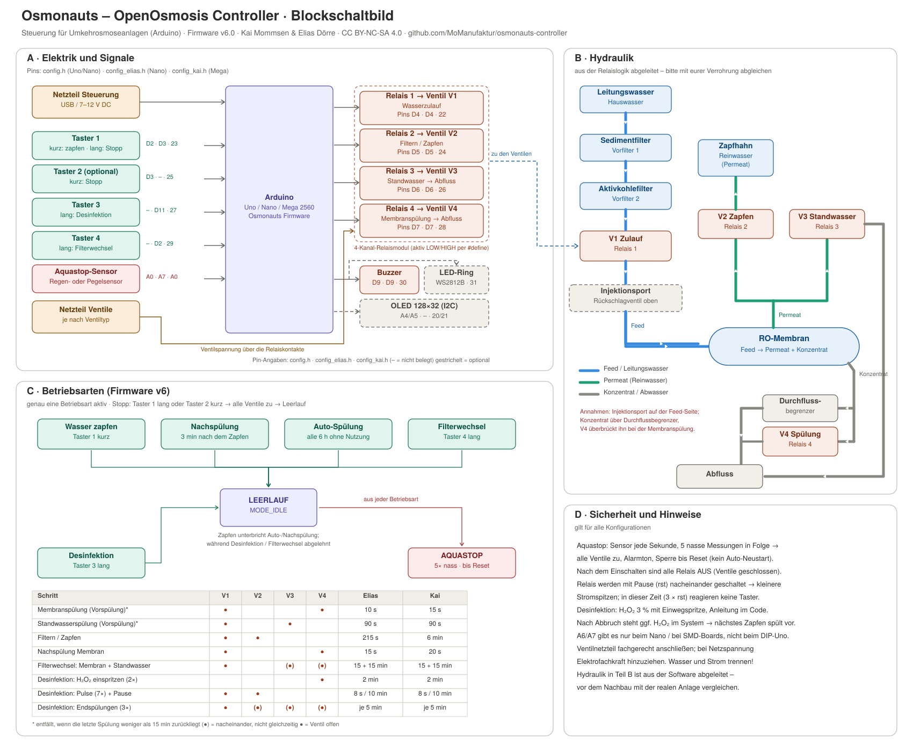

# Osmonauts – OpenOsmosis Controller

**Reverse osmosis controller for Arduino – free for private, non-commercial use**
by **Kai Mommsen & Elias Dörre**

[](LICENSE)
[](https://github.com/MoManufaktur/osmonauts-controller/issues/new?template=build-report.yml)

Osmonauts turns a DIY reverse osmosis (RO) system into a self-cleaning water station: it flushes the
membrane before and after every tapping, rinses out standing water, flushes automatically when the
system has not been used for hours, guides you through filter exchange and disinfection, and shuts
everything down if a leak is detected.

> *Osmonauts* is the community name of the project – *OpenOsmosis Controller* is what it does.

---

## Features

- **Pre-flush** of membrane and standing water before tapping (skipped if the last flush was less than 15 min ago)
- **Delayed post-flush** of the membrane after tapping – fill several bottles in a row without flushing in between
- **Automatic flush** after 6 h without use (keeps germs out of standing water)
- **Filter exchange** procedure: 15 min membrane flush + 15 min standing water flush
- **Disinfection** routine with hydrogen peroxide (H₂O₂ 3 %), ≈ 90 min, fully automatic after the two injections
- **Aqua stop**: rain sensor or water level sensor, closes all valves and locks the controller until reset
- **Stop button**: cancels any running procedure and closes all valves
- Acoustic feedback (passive buzzer), optional **WS2812B LED ring** and **128×32 OLED** display
- Non-blocking state machines, one operating mode at a time, every procedure with its own timer
- **PC simulation tests** – the complete firmware runs on your computer with simulated time

## See how it works

| | |
|---|---|
| **Block diagram** – electrics, hydraulics, operating modes, valve matrix | [`docs/osmonauts_blockschaltbild.svg`](docs/osmonauts_blockschaltbild.svg) |
| **3D animation** of all flushing procedures (interactive, works offline) | [`docs/osmonauts_spuelvorgaenge_3d.html`](docs/osmonauts_spuelvorgaenge_3d.html) – download and open in a browser, or enable GitHub Pages |
| **Code review** of version 5 and test results of version 6 (German) | [`docs/code-review.md`](docs/code-review.md) |



## Hardware

| Part | Notes |
|---|---|
| Arduino Uno, Nano or Mega 2560 | Mega recommended when using LED ring **and** OLED (RAM) |
| 4-channel relay module | active LOW or active HIGH – set `ON` / `OFF` in the config |
| 4 solenoid valves | V1 water supply · V2 filter/tap · V3 standing water → drain · V4 membrane flush → drain |
| 2–4 push buttons | against GND, internal pull-ups are used |
| Aqua stop sensor | rain sensor (low value = wet) or water level sensor (high value = wet) |
| Passive buzzer | acoustic feedback |
| optional: WS2812B LED ring | Adafruit NeoPixel library |
| optional: SSD1306 OLED 128×32, I2C | Adafruit SSD1306 + Adafruit GFX library |
| RO system | sediment filter, carbon filter, RO membrane, flow restrictor in the concentrate line |

The hydraulic schematic in the block diagram is derived from the relay logic of the firmware –
please compare it with your own plumbing before building.

### Pin mapping

| Function | `config.h` (Uno/Nano) | `config_elias.h` (Nano) | `config_kai.h` (Mega) |
|---|---|---|---|
| Relay 1 – V1 water supply | D4 | D4 | 22 |
| Relay 2 – V2 filter / tap | D5 | D5 | 24 |
| Relay 3 – V3 standing water | D6 | D6 | 26 |
| Relay 4 – V4 membrane flush | D7 | D7 | 28 |
| Button 1 – tap / stop | D2 | D3 | 23 |
| Button 2 – stop | D3 | – | 25 |
| Button 3 – disinfection | – | D11 | 27 |
| Button 4 – filter exchange | – | D2 | 29 |
| Aqua stop sensor | A0 | A7 ¹ | A0 |
| Buzzer | D9 | D9 | 30 |
| LED ring | – | – | 31 |
| OLED (I2C) | – | – | SDA 20 / SCL 21 |

¹ A6/A7 only exist on the Nano and SMD boards, not on a DIP Uno.

## Operation

| Button | Short press | Long press (≥ 1.5–2 s, on release) |
|---|---|---|
| 1 | tap water | **stop** |
| 2 (optional) | **stop** | – |
| 3 | – | disinfection |
| 4 | – | filter exchange |

Tapping interrupts an automatic flush or post-flush. During disinfection or filter exchange a tapping
request is refused (three short beeps) – stop the running procedure first.

### Procedures and valve states

| Step | V1 | V2 | V3 | V4 | Elias | Kai |
|---|:-:|:-:|:-:|:-:|---|---|
| Pre-flush membrane * | ● | | | ● | 10 s | 15 s |
| Pre-flush standing water * | ● | | ● | | 90 s | 90 s |
| Filter / tap | ● | ● | | | 215 s | 6 min |
| Wait before post-flush | | | | | 3 min | 1 min |
| Post-flush membrane | ● | | | ● | 15 s | 20 s |
| Filter exchange (membrane, then standing water) | ● | | (●) | (●) | 15 + 15 min | 15 + 15 min |
| Disinfection: inject H₂O₂ (2×) | | | | ● | 2 min | 2 min |
| Disinfection: pulse + pause (7×) | ● | ● | | | 8 s / 10 min | 8 s / 10 min |
| Disinfection: final flushes (membrane, standing water, filter) | ● | (●) | (●) | (●) | 3 × 5 min | 3 × 5 min |

\* skipped if the last flush was less than 15 min ago · (●) = one after the other, not at the same time · the automatic flush runs pre-flush + post-flush.

### Disinfection

1. Remove the plug from the upper one-way valve and insert a short hose piece.
2. Long press button 3 (short beep).
3. Inject 20 ml hydrogen peroxide (3 %) with a disposable syringe – valve 4 is open to release the pressure.
4. After 2 min the H₂O₂ is moved into the system; at the next beep inject another 20 ml.
5. The controller pushes the H₂O₂ through the system in 7 pulses with 10 min pauses – **put a container under the tap.**
6. Final flushes of membrane, standing water and filter (5 min each). Long beep: finished.
   The next tapping always starts with a pre-flush.

## Getting started

1. Open `firmware/osmonauts_controller/osmonauts_controller.ino` in the Arduino IDE.
2. Choose your configuration at the top of the sketch (`config.h`, `config_elias.h`, `config_kai.h`)
   or copy `config.h` and adapt pins, relay type, sensor type and durations.
3. With LED ring / OLED install the libraries *Adafruit NeoPixel*, *Adafruit SSD1306* and *Adafruit GFX*.
4. Start with `#define OPERATION_TESTING` (short durations) on the bench, check every valve, then switch
   to `OPERATION_NORMAL`.
5. Serial monitor at 115200 baud shows every step.

### Simulation tests (no hardware needed)

The firmware compiles for the PC against a small Arduino mock; time is simulated, every relay change is recorded.

```bash
tests/run.sh config_elias.h tap tap2 stop stopfilter disinfect busy filterchange auto tapduringauto tapduringpost aquastop bounce
```

12 scenarios / 25 checks: tapping, consecutive tapping, stop, stop while filtering, disinfection timing,
busy lock, filter exchange, automatic flush, tapping during automatic flush and post-flush, aqua stop,
bouncing buttons. Requires `g++`.

## Safety

- After power-on all relays are off – all valves closed.
- Aqua stop: 5 consecutive wet readings (one per second) close all valves; the controller stays locked until reset.
- Water and electricity: connect the valve power supply properly; for mains voltage ask a qualified electrician.
- This is a DIY project without any certification. Use at your own risk and check the water quality of your system.

## Built one? Tell us!

We would love to know where Osmonauts is running. Please register your build – it takes two minutes
and helps the project grow:

**[→ Register your Osmonauts build](https://github.com/MoManufaktur/osmonauts-controller/issues/new?template=build-report.yml)** ·
[see all builds](https://github.com/MoManufaktur/osmonauts-controller/issues?q=label%3Abuild-report)

The controller itself has **no network connection and sends no data** – reports are voluntary.
Every controller announces itself at start-up on the serial monitor with name, authors, link and
license; please keep this message in your version (it is part of the attribution required by the license).

## Repository structure

```
firmware/osmonauts_controller/   Arduino sketch, configuration files, LED helper
tests/                           PC simulation (Arduino mock + test scenarios)
docs/                            block diagram (SVG/PNG), 3D animation, code review, media
tools/                           generators for block diagram and 3D animation, traffic archive script
.github/                         build report form, daily traffic archive (GitHub keeps only 14 days)
```

## History

Developed since March 2021 by Kai Mommsen and Elias Dörre.
Version 6 (November 2026): complete review – own timer per procedure, central operating mode,
real stop, corrected disinfection, debounced buttons, RAM optimisation for the OLED, simulation tests.
The full change history is kept in the header of the sketch.

## Authors

- **Kai Mommsen** – relay logic and timing, aqua stop, membrane post-flush, LED/OLED feedback, Mega port, testing mode
- **Elias Dörre** – non-blocking state machines, configuration system, stop button, filter exchange, disinfection, tapping logic

See [AUTHORS.md](AUTHORS.md).

## License

Copyright © 2021–2026 Kai Mommsen & Elias Dörre

Osmonauts is licensed under **[Creative Commons Attribution-NonCommercial-ShareAlike 4.0 International (CC BY-NC-SA 4.0)](LICENSE)**:

- ✅ **Private use** – build it, use it, learn from it
- ✅ **Modify** – adapt it to your system
- ✅ **Share** – if you publish your modified version, it must be under **the same license** and credit the original
- ❌ **No commercial use** – selling controllers, kits or systems with this firmware, or using it in a business,
  requires a written permission (commercial license) from the authors
- 📌 **Attribution** – name *Osmonauts – OpenOsmosis Controller*, Kai Mommsen & Elias Dörre, link to this repository,
  and keep the start message of the firmware

Because of the non-commercial clause Osmonauts is *source-available*, not open source in the OSI sense.
For a commercial license please open an issue with the label `commercial-license` or contact the authors.

Third-party parts keep their own licenses: `LED.h` is based on “Multi-tasking the Arduino – Part 3” by
Bill Earl (Adafruit); the 3D animation embeds three.js (MIT License).

---

## Deutsch – Kurzfassung

**Osmonauts – OpenOsmosis Controller** ist eine offene Steuerung für Umkehrosmoseanlagen auf Arduino-Basis,
entwickelt von **Kai Mommsen und Elias Dörre**. Sie spült die Membran vor und nach jedem Zapfen, verwirft
Standwasser, spült nach 6 h ohne Nutzung automatisch, führt durch Filterwechsel und Desinfektion (H₂O₂) und
schließt bei einem Leck über den Aquastop alle Ventile. Blockschaltbild und 3D-Animation aller Spülvorgänge
liegen im Ordner `docs/`, die Bedienung steht oben in den Tabellen.

**Lizenz:** CC BY-NC-SA 4.0 – frei für die private, nicht kommerzielle Nutzung. Änderungen sind erlaubt;
wer eine geänderte Version weitergibt, muss sie unter derselben Lizenz und mit Namensnennung veröffentlichen.
Kommerzielle Nutzung nur mit schriftlicher Genehmigung der Autoren.
**Nachgebaut?** Bitte über das [Formular](https://github.com/MoManufaktur/osmonauts-controller/issues/new?template=build-report.yml) melden.
